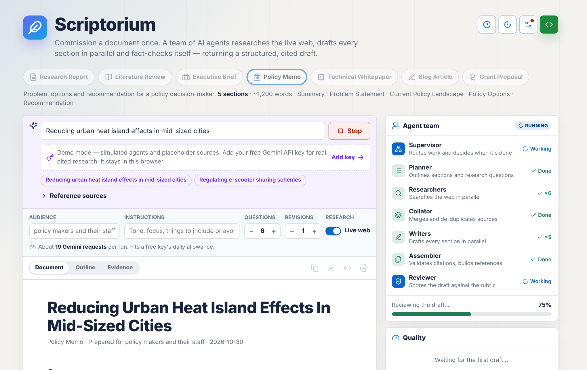
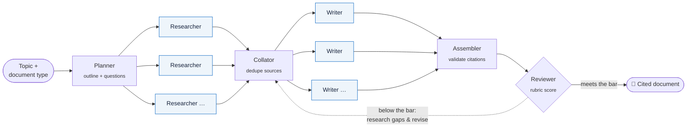

<div align="center">


# Scriptorium

**Autonomous multi-agent research & document drafting.**<br/>
Commission a document once. A team of AI agents researches the live web, drafts every section in parallel and fact-checks itself — returning a structured, citation-backed draft.

[**▶ Try it live**](https://valentinakiyungi.github.io/scriptorium/) · [How it works](#how-it-works) · [Quick start](#quick-start) · [Document types](#document-types)

[](https://github.com/valentinakiyungi/scriptorium/actions/workflows/pages.yml)


<br/>

<picture>
  <source media="(prefers-color-scheme: dark)" srcset="docs/screenshot-dark.png" />
  
</picture>

</div>

---

## Why Scriptorium

Writing a well-sourced report means hours of searching, reading, outlining, drafting and checking citations. Scriptorium hands that loop to a coordinated team of agents — and shows you every step.

| | |
|---|---|
| 🧭 **Supervisor-Worker orchestration** | A LangGraph supervisor plans the work, dispatches specialist agents and decides when the document is good enough. |
| ⚡ **Parallel research & drafting** | Researchers answer every question at once; writers draft every section at once — using LangGraph's `Send` fan-out. |
| 🔎 **Live, grounded research** | Gemini with Google Search grounding, plus your own files, URLs and notes as citable sources. |
| 📚 **Citations you can trust** | Sources are de-duplicated, invented citations are removed, and references are renumbered automatically. |
| ✅ **Self-review loop** | A reviewer scores each draft against a rubric for the document type and sends it back to research the gaps and revise. |
| 🗂️ **7 document types** | Research reports, literature reviews, executive briefs, policy memos, whitepapers, blog articles and grant proposals. |
| 🔐 **Private by design** | The hosted version runs entirely in your browser — your API key never touches a server. |
| 🛟 **Resilient to API limits** | Handles rate limits, daily quotas and retired models by waiting or switching models automatically. |

## Try it

**Online — nothing to install:** open **[valentinakiyungi.github.io/scriptorium](https://valentinakiyungi.github.io/scriptorium/)**.

- Press **Try demo** to watch the full agent workflow with simulated output.
- For real research, open ⚙️ **Settings** and paste a free [Gemini API key](https://aistudio.google.com/apikey). It's stored only in your browser and sent only to Google.

## How it works



<sub>Between every step, the **Supervisor** reads the shared graph state and decides who works next — and when the document is done.</sub>

| Agent | Responsibility |
|---|---|
| **Supervisor** | Deterministic, auditable router over shared graph state. Dispatches workers and enforces the revision budget. |
| **Planner** | Tailors the document type's outline to the topic and writes sharp, searchable research questions within a budget. |
| **Researchers** | One per question, in parallel. Gemini + Google Search grounding; grounding metadata becomes precise inline citations. Also searches attached documents (BM25). |
| **Collator** | Merges every researcher's sources into one registry — tracking parameters stripped, duplicates removed, stable ids. |
| **Writers** | One per section, in parallel. Each gets its own evidence first, the outline, the document's voice and a word budget. |
| **Assembler** | Orders sections, drops any citation that doesn't match a real source, renumbers by first appearance and builds the references. |
| **Reviewer** | Scores 1–10 against the type's rubric, gives section feedback and proposes gap research. Revisions rewrite only the sections that need it. |

## Document types

| Type | Sections |
|---|---|
| **Research Report** | Executive Summary · Background · Key Findings · Analysis · Implications & Recommendations · Conclusion |
| **Literature Review** | Introduction & Scope · Major Themes · Debates & Contradictions · Methodological Trends · Research Gaps · Conclusion |
| **Executive Brief** | Bottom Line · Situation · Options · Recommendation & Next Steps |
| **Policy Memo** | Summary · Problem Statement · Current Policy Landscape · Policy Options · Recommendation |
| **Technical Whitepaper** | Abstract · Problem & Motivation · Technical Approach · Performance & Evaluation · Trade-offs · Adoption Guidance |
| **Blog Article** | Introduction · What's Going On · What the Evidence Says · Different Perspectives · Takeaways |
| **Grant Proposal** | Project Summary · Statement of Need · Aims & Objectives · Approach & Methods · Impact & Evaluation · Budget & Timeline |

Each type defines its tone, target length and review rubric in [`src/doctypes.ts`](src/doctypes.ts) — add your own in a few lines.

## Quick start

Run locally to search your own document folder and save every draft to disk.

**Requirements:** Node.js 20+ and a [Gemini API key](https://aistudio.google.com/apikey).

```bash
git clone https://github.com/valentinakiyungi/scriptorium.git
cd scriptorium
npm install
npm run web            # → http://localhost:3000, then add your key in ⚙️ Settings
```

Prefer the terminal?

```bash
cp .env.example .env   # paste your key into GEMINI_API_KEY
npm run draft -- "Grid-scale battery storage in 2026" --type research-report
npm run draft -- "Passkeys vs passwords" -t technical-whitepaper -a "CTOs" -i "Focus on rollout cost"
```

Every run writes `output/<timestamp>-<topic>/document.md` plus `run.json` (plan, evidence, sources, reviews, agent trace, timings and token usage).

<details>
<summary><b>All CLI options</b></summary>

| Option | Default | Description |
|---|---|---|
| `-t, --type` | `research-report` | Document type id (`npm run types` lists them) |
| `-a, --audience` | per type | Who the document is for |
| `-i, --instructions` | – | Tone, focus, constraints |
| `-q, --max-questions` | `6` | Research questions in the plan |
| `-r, --max-revisions` | `1` | Reviewer-driven revision rounds |
| `--no-web` | – | Use only local documents in `./data` |
| `--data <dir>` | `./data` | Local corpus folder |
| `--mock` | – | Offline demo, no API key needed |

</details>

<details>
<summary><b>Configuration (<code>.env</code>)</b></summary>

| Variable | Default | Description |
|---|---|---|
| `GEMINI_API_KEY` | – | Required unless `--mock` |
| `GEMINI_MODEL` | `gemini-3.8-flash` | Planner, writers, reviewer. Switches automatically if Google retires it |
| `GEMINI_RESEARCH_MODEL` | same | Optional separate (e.g. Flash-Lite) model for researchers |
| `SCRIPTORIUM_CONCURRENCY` | `4` | Max simultaneous Gemini calls |
| `SCRIPTORIUM_PASS_SCORE` | `8` | Reviewer score that ends revisions |
| `SCRIPTORIUM_DATA_DIR` | `./data` | Local research corpus |
| `SCRIPTORIUM_OUTPUT_DIR` | `./output` | Where documents are saved |
| `PORT` | `3000` | Web app port (falls back to the next free port) |

</details>

<details>
<summary><b>Gemini quotas & limits</b></summary>

Free Gemini keys allow roughly **20 requests per model per day**; one document uses about 12–25 (the app shows an estimate before you start). Scriptorium handles limits for you:

- **Per-minute limits** — waits as long as Google asks, then retries.
- **Daily limits** — never retries an exhausted model; switches to the next model your key can use (each has its own quota) and notes it in the Activity log.
- **Retired models** — switches to the best available model and remembers it.

For regular use, enable billing in [Google AI Studio](https://aistudio.google.com/) — limits rise immediately.

</details>

## Architecture

```
src/
├── graph.ts              LangGraph state + Supervisor-Worker wiring (Send fan-outs, reducers)
├── pipeline.ts           Browser-safe runner: streams events, computes metrics
├── agents/
│   ├── supervisor.ts     Routing policy: plan → research → write → review → revise / finish
│   ├── planner.ts        Outline + research questions
│   ├── researcher.ts     Grounded web + local research with citations
│   ├── writer.ts         Section drafting and revision
│   └── reviewer.ts       Rubric scoring, gap detection, lint checks
├── citations.ts          Grounding → markers, source de-dup, validation, renumbering
├── doctypes.ts           7 document templates with rubrics
├── local-docs.ts         BM25 search over attached and local documents
├── llm/                  Gemini REST client (retries, quotas, model fallback) + offline mock
├── browser.ts            In-browser API for the GitHub Pages build
├── run.ts · server.ts    Node runner (saves to disk) and local web server
└── cli.ts · bench.ts     Command line and benchmark suite
public/index.html         The web app (no framework, no CDN dependencies)
scripts/build-pages.mjs   Static build for GitHub Pages (esbuild)
test/                     Unit + end-to-end tests (offline, mock and fake-Gemini)
```

The same LangGraph pipeline powers three front-ends: the hosted **browser app** (GitHub Pages), the **local web app** (`npm run web`) and the **CLI**.

## Development

```bash
npm test               # 20 tests, fully offline
npm run typecheck
npm run demo           # local web app with the mock model
npm run build:pages    # static site → dist/pages
npm run bench          # one task per document type, writes a benchmark report
```

### Deployment

Every push to `main` runs the tests, builds the static site and publishes it to GitHub Pages via [`.github/workflows/pages.yml`](.github/workflows/pages.yml).

## Roadmap

- [ ] Export to Word and PDF with formatted references
- [ ] Custom document types from the UI
- [ ] Additional search providers alongside Google Search grounding
- [ ] Side-by-side comparison of revision rounds

## License

[MIT](LICENSE) © Valentina Kiyungi
